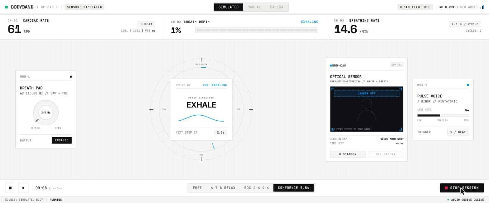

# Body Band

**Music from your heartbeat and breath.** Body Band reads your pulse and breathing through a
webcam with the [Presage SmartSpectra SDK](https://smartspectra.presagetech.com/) and turns
them into live music and visuals. Your heartbeat sets the rhythm; your breath shapes the sound.
Nothing to wear, hold or press.

Built for the Presage SmartSpectra SDK Challenge (November 2026).

**Try it:** https://bodyband.vercel.app — the Simulated and Manual modes, with no install.
Camera mode reads a webcam through the SmartSpectra SDK on your own PC, so it can't run on a
hosted page; see [Run it](#run-it) below.



## How it works

| Your body | The music | On screen |
| --- | --- | --- |
| Breathing in and out | Opens and closes a warm pad sound | The blue arc on the dial fills and empties |
| Each heartbeat | A soft kick plus one note | The beat light flashes; the last note is shown |
| Pulse speed | Higher pulse = higher, brighter notes | Pulse and beat-to-beat times |

Notes always come from one scale (A minor pentatonic), so it sounds pleasant whatever your body does.

## Three ways to play

| Source | What it is | Needs |
| --- | --- | --- |
| **Simulated** | A believable fake body, for demos | Nothing |
| **Manual** | Hold Space (or press the stage) to breathe in, release to breathe out | Nothing |
| **Camera** | Your real pulse and breathing from the webcam | SmartSpectra API key |

There are also three breathing guides (4-7-8, Box, Coherence). The needle on the dial shows
where the guide wants your breath to be; you try to keep the arc on it, and a SYNC score
shows how closely your breathing follows.

## Quick start for a tester (Windows, no terminal)

Camera mode reads a webcam on the computer that runs the app, so to try it with your own
webcam you run Body Band on your own computer. It takes a few minutes the first time.

1. On the [GitHub page](https://github.com/abdullahrauf245-hue/BODY-BAND), press **Code**, then **Download ZIP**, and unzip it.
2. Double-click **`BodyBand.bat`**.
3. The first time it may ask you to install two free things from Microsoft and Node.js (it opens the download page and tells you); do that, then double-click `BodyBand.bat` again. It then installs the app (about 400 MB, a few minutes) and asks for a **Presage API key**: get your own free one at [physiology.presagetech.com](https://physiology.presagetech.com/). The key is saved only on your computer.
4. The browser opens Body Band. Pick **CAMERA** → **START SESSION**. The camera check shows your webcam first and uses no key minutes; measuring starts only when you press START MEASURING, and stops by itself after 2 minutes.

Not on Windows: the SDK also supports Apple Silicon Macs and Linux. Install [Node.js](https://nodejs.org/), run `npm install`, copy `.env.example` to `.env` and put your key in it, then run `npm start` (details below).

## Run it

Requirements: Windows 10/11 (64-bit), [Node.js](https://nodejs.org/) 20 or newer, and for
camera mode a webcam plus the latest
[Microsoft Visual C++ runtime](https://learn.microsoft.com/cpp/windows/latest-supported-vc-redist).

```
git clone https://github.com/abdullahrauf245-hue/BODY-BAND.git
cd BODY-BAND
npm install
```

For camera mode, get an API key from [physiology.presagetech.com](https://physiology.presagetech.com/)
and put it in a file called `.env` in the project folder:

```
PRESAGE_API_KEY=your-key-here
```

Then start it and open **http://localhost:3000**:

```
npm start
```

Pick a source at the top, press **START SESSION**, and turn your sound on.

Simulated and Manual modes also work by just double-clicking `index.html`, with no install.

### Tips for camera mode

- Face the camera in good light, with your face and chest in frame, and sit fairly still.
- Before every camera session a **camera check** opens: it explains what will happen, shows
  your webcam through the browser with a head-and-chest outline, and measures its frame rate
  and light. It uses no SDK minutes. Nothing starts until you press START MEASURING.
- During the session the camera panel shows your live picture (mirrored).
- Hints such as "face not centered" appear in the camera panel.
- The SDK needs at least 25 camera frames a second. The panel's CAMERA FEED row shows what
  your webcam is delivering; if it is lower, add light. The camera mode defaults to 640x480
  at 30 and can be changed with `PRESAGE_CAMERA=1280x720@30` in `.env`.
- **Using a phone as the webcam** (often steadier in dim light): install a phone-webcam app such as
  Iriun Webcam or DroidCam on the phone and its PC program, connect by USB or the same Wi-Fi, and
  check the phone shows up as a camera. Run `npm run cameras` to see its name, then add part of
  it to `.env`, for example `PRESAGE_CAMERA_NAME=Iriun`, and restart. The camera check then shows
  the phone, and a session refuses to start (instead of using the laptop webcam) if it isn't connected.
- Each camera session **stops by itself after 2 minutes** (and when you press Stop or close
  the tab), so SDK minutes are never used by accident. Change the limit with
  `PRESAGE_MAX_SECONDS` in `.env`.

## Privacy

- The API key stays in `.env` on your PC. It is ignored by git and never sent to the browser.
- Body Band does not record, store or upload video or vitals. The live picture in the camera
  panel goes from the SDK to your own browser on the same PC and is held in memory only while
  a session runs. The SmartSpectra SDK contacts Presage to check the API key, count usage
  and fetch its models; its telemetry reports are turned off (`enableTelemetry: false`).
  See Presage's documentation for details.
- Camera consent: the camera check above asks before every session.
- The server only listens on your own PC (`127.0.0.1`), and only the Body Band page itself
  can start the camera or read its picture.

Body Band is an art and wellbeing project, **not a medical device**. Do not use its readings
for any health decision.

## No training data

Body Band has no machine learning of its own, so there is nothing to train. Reading pulse and
breathing from video is done by the SmartSpectra SDK, which ships already built by Presage.
Everything Body Band adds is plain rules: this signal moves that sound.

## Project layout

| File | Job |
| --- | --- |
| `server.js` | Serves the page; runs the SmartSpectra camera session and streams it to the page |
| `preview.js`, `camview.js` | The live camera picture: shrink it on the server, paint it on the page |
| `test/` | Tests for the signal logic and the picture conversion (`npm test`) |
| `signals.js` | The three signal sources, all emitting the same events |
| `vitals.js` | The signal logic: breath scaling, pulse filtering, breath counting, guides and the sync score |
| `audio.js` | The music engine (Web Audio, no libraries) |
| `app.js` | The console: dial, readouts, breathing guides, start/stop |
| `index.html`, `styles.css` | Page and look |
| `docs/PRD.md` | What we are building and why |
| `docs/TRD.md` | How it is built |

## Status

Working: the console UI, the music, Simulated and Manual modes, breathing guides, and the
server with its safety limits. Camera mode is built and the SDK loads and finds the webcam;
tuning it against real readings is the next step.

## Built with

Presage SmartSpectra Node SDK · Node.js · Web Audio API · SVG. Interface design made with
Google Stitch; code written with Claude Code.
